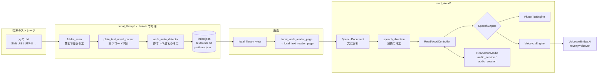

# Novelty-local 設計メモ（開発者向け）

フォーク「Novelty-local」で足した部分の設計をまとめたものです。元の Novelty の設計は
[docs/architecture/](../architecture/) と [docs/adr/](../adr/)、用語は [CONTEXT.md](../../CONTEXT.md) を見てください。
利用者向けのやさしい解説は [README.md](README.md) にあります。

## 1. 全体像

Web 小説（なろう・カクヨム）の読書画面 `novel_page.dart` も、同じ `ReadAloudController` と
`ReadAloudMedia` を使います。本文の描画は元の Novelty の `NovelContentView`（`narou_parser` の要素型）を
そのまま使い、ローカルのテキストもその要素型に変換してから渡します。

## 2. モジュールの責務

| 層 | ファイル | 責務 | 端末の機能 |
|---|---|---|---|
| 永続化 | `local_library/local_library_store.dart` | JSON・本文ファイルの読み書き、取り込み・再スキャンの段取り | ファイルのみ |
| 純粋ロジック | `local_library/folder_scan.dart` | 差分の判定（`planScan`）、元ファイルの読み込みと UTF-8 化 | ファイルのみ |
| 純粋ロジック | `local_library/work_meta_detector.dart`・`meta_rules.dart` | 作者・作品名の推定ルール | なし |
| 状態 | `local_library/local_library_providers.dart` | Riverpod の `AsyncNotifier` 群（手書き、コード生成なし） | なし |
| 純粋ロジック | `utils/plain_text_novel_parser.dart` | 文字コード判別・本文の掃除・ルビ解析 | なし |
| 純粋ロジック | `read_aloud/speech_document.dart`・`speech_direction.dart` | 文への分割、演技（役割・感情・間）の推定 | なし |
| 状態機械 | `read_aloud/read_aloud_controller.dart` | 再生・一時停止・移動、先読み、世代管理 | 静的フック経由のみ |
| 純粋ロジック | `read_aloud/read_aloud_remote.dart` | ボタン・割り込みを操作に置き換える規則 | なし |
| 端末連携 | `read_aloud/read_aloud_media.dart` | メディアセッション・音のフォーカス | audio_service / audio_session |
| 端末連携 | `read_aloud/voicevox_engine.dart` ↔ `VoicevoxBridge.kt` | VOICEVOX の合成と再生 | MethodChannel |

「純粋ロジック」の層は端末の機能に触らず、`flutter test` だけで振る舞いを固定しています。
端末連携の層は薄く保ち、判断はすべて純粋ロジックの層に寄せています。

## 3. 保存先

`getApplicationDocumentsDirectory()/local_library/`：

| ファイル | 中身 | 備考 |
|---|---|---|
| `index.json` | 作品一覧（`LocalWork`） | |
| `texts/<id>.txt` | 本文 | 取り込み時に UTF-8 へ正規化して複製する |
| `positions.json` | 読書位置・しおり | 表示方式ごとの位置と、読み上げ位置（`ttsOffset`） |
| `rules.json` / `authors.json` | 作者の読み取りルール / 表示名と読み | |
| `sources.json` | 再スキャン用に覚えたフォルダと、ファイルごとの署名 | |
| `playlist.json` / `text_options.json` | 連続再生リスト / 読み込み設定 | |

Web 小説の話ごとの位置は `reader/web_positions.json`（`utils/web_reading_positions.dart`）。

約束ごと:

- **書き込みは原子的**：一時ファイルに書いてから rename（`_writeAtomically`）。
- **作品 ID = ファイル名の FNV ハッシュ**：同じ名前のファイルを取り込み直しても、しおりが残る。
- **本文の掃除・表記ゆれは表示のときに適用**し、`texts/` には元の文字のまま持つ（設定を切り替えられるように）。

## 4. スレッドと Isolate

- 取り込み・再スキャン・UTF-8 化・本文の解析・読み仮名の辞書の展開は `Isolate.run` で行います。
- `Isolate.run` に渡すクロージャは**必ずトップレベル関数を経由**します。メソッドの中で
  クロージャを作ると `this`（ストアや Riverpod の参照）をつかみ、Isolate に送れずに落ちるためです。
- VOICEVOX の合成は Kotlin 側の専用スレッド1本で行います（優先度キュー）。

## 5. 読み上げ

### 5-1. 再生ループ

`ReadAloudController._loop` は文ごとに `apply（声の調整）→ speak → 次の文を prefetch` を繰り返します。

- **世代番号**：再生・移動・停止のたびに `_generation` を進め、`await` から戻るたびに比べます。
  古いループは何もせずに抜けるので、ロックが要りません。
- **読み方の辞書は音声にだけ効く**：`ReadingDictionary.apply` で置き換えるのはエンジンに渡す文字列だけで、
  `SpeechSegment` の文字位置（しおり・読書位置の基準）は変えない。長い表記から1回だけ置き換える。
- **一時停止は文の頭から再開**：端末の音声合成も VOICEVOX も、文の途中からは再開できないためです。
- **先読みの順番**：今の文を頼んでから、次の文の先読みを送ります。逆にすると、VOICEVOX の
  キューで今の文が先読みの後ろに回ります。

### 5-2. VOICEVOX

- コアは `voicevox_core` 0.17.1 の Java API、ONNX Runtime 1.23.2、Open JTalk の辞書を CI で取得して APK に同梱します。
  声のモデルは 0・2・5・15・21 の `.vvm` です。
- メモリの扱いは `VoicevoxBridge.kt` の先頭のコメントにまとめています。要点は次の4つです。
  1. 声のモデルは使うときに読み込みます。
  2. 同時に持つモデルは2〜3個までです。
  3. ネイティブヒープを監視します。
  4. Dart 側で長い文を80文字までに分けます。
  過去に、長時間の読み上げでネイティブのメモリ不足（scudo）で落ちていたことへの対策です。
- VOICEVOX が使えないときは、そのセッションの間は端末の音声合成に切り替えます。切り替えるときは、
  端末の声の設定を先に適用してから読みます（適用前に読むと、文が一瞬で飛ばされるため）。

### 5-3. 画面の外からの操作（運転中）

- `ReadAloudController` は端末の機能を知りません。読み始めと後始末のときに静的フック
  （`onStartedPlaying` / `onDisposed`）を呼ぶだけです。`ReadAloudMedia.init()` がフックを登録します。
- **割り込みの規則**は `ReadAloudRemote` にあり、テストで固定しています。
  - ナビの案内（duck）と電話（pause）：止めて、終わったら同じ文から再開します。
  - 他のアプリに音を取られたとき（unknown）とユーザーが止めたとき：再開しません。
  - Bluetooth が切れたとき：止めます。
  - `AudioSessionConfiguration.speech()` は `androidWillPauseWhenDucked: true` なので、
    OS は自動で音量を下げず、知らせだけを送ってきます。
- **フォアグラウンドサービスを切らさない**：画面が消えている間は、Android 12 以降、
  フォアグラウンドサービスを新しく始められません。次のように扱います。
  - 一時停止中もサービスは止めません（`androidStopForegroundOnPause: false`）。
  - 話・作品の切り替わりでは、45秒間「再生中（buffering）」として待ちます。
- **連続再生は build の外で進める**：画面が消えている間は Flutter がフレームを作らず、build が走りません。
  そこで、次の作品の読み込み・解析・読み上げの作成と開始を `LocalWorkReaderPage` のコールバックの中で行い、
  できた読み上げを `LocalTextReaderPage(sharedReadAloud: …)` に渡します。
- **連続再生リストは画面を開かずに流す**：`PlaylistPlayer`（Riverpod の `Notifier`）が、ローカルの作品と Web 小説を
  読み込み、読み上げを作って始め、読み終えたら次の作品・次の話へ進みます。
  - Web 小説は、閲覧履歴の「最後に読んだ話」から最終話まで読みます。話を進めるたびに履歴も進めます。
  - リストの鍵は、ローカルは作品 ID、Web は `web:<サイト>:<作品 ID>` です。前の版のリスト（ID だけ）もそのまま読めます。
  - 端末の声は1つなので、`ReadAloudController` は新しい読み上げが始まると前のものを止めます。
    このときエンジンの停止は呼びません（新しい読み上げの声まで止まるため）。
- `MainActivity` は `AudioServiceActivity` を継承します。FlutterEngine がキャッシュされ、Activity より長く生きるので、
  `VoicevoxBridge` は companion object でアプリ全体に1つだけ持ち、Activity が作り直されても使い回します。

## 6. 文字コード

`PlainTextNovelParser.decodeDetailed` は次の順に試します。

1. **BOM**：UTF-8 / UTF-16LE / UTF-16BE を見分けます。
2. **BOM の無い UTF-16**：1バイトおきに 0 が並んでいるかで判定します。0 のバイトは UTF-8 としては正しいので、UTF-8 より先に見ます。
3. **UTF-8**：厳密に読みます（不正なバイトがあれば次へ進みます）。
4. **Shift_JIS（CP932）と EUC-JP**：両方で読み、`errors × 100 + 半角カナの数` が小さいほうを採ります。
   - 半角カナを数えるのは、EUC-JP を Shift_JIS として読むと、エラーにならずに半角カナだらけになるためです。
   - 読めないバイトが 16 個を超え、しかも全体の 2% を超えたら、テキストではないとみなします。

対応表は `tool/gen_japanese_tables.py` が Python の `cp932` / `euc_jp` のコーデックから作り、zlib と base64 で
`lib/utils/japanese_legacy_tables.dart` に埋め込みます（約 57KB）。依存パッケージは増やしていません。

元ファイルの UTF-8 化（任意）は、読めないバイトが1つでもあれば行いません。書き直したファイルは署名を測り直すので、
次の再スキャンで「書き換わった」とは扱いません。

## 7. CI と配布

`.github/workflows/ci.yml`：

| ジョブ | 内容 |
|---|---|
| Analyze & Test | `flutter analyze`（info も 0 件が条件）・`flutter test` |
| Test (tategaki) | `packages/tategaki` のテスト |
| Build Android APK | VOICEVOX の取得 → release ビルド → リリース `apk-latest` に `novelty-local.apk` を上書きで公開 |

- **署名**：リポジトリの Secret `ANDROID_KEYSTORE_BASE64`（JKS、エイリアス `novelty`、パスワード `android`）を使います。
  - Secret が無いときは、その場で作った鍵で署名し、警告を出します。その APK は前の版の上からは入りません。
  - 鍵は **RSA 2048 / SHA256withRSA** にしてください。RSA 4096 / SHA384withRSA の鍵で署名した APK は、
    署名の検証が通るのに Xiaomi（HyperOS）の端末で「パッケージが無効」として入りませんでした。
- APK は約 450MB あり、そのほとんどが声のモデル（約 300MB）です。リリースへ直接上げているのは、
  スマホでは Actions の成果物（zip）を展開できなかったためです。
- R8 が VOICEVOX のコアと Gson のクラスを消さないよう、`android/app/proguard-rules.pro` で残しています。

## 8. テスト

| 対象 | テスト |
|---|---|
| 文字コード・本文の掃除・ルビ | `test/utils/plain_text_novel_parser_test.dart` |
| 表記ゆれ | `test/utils/text_width_test.dart` |
| 取り込み・再スキャン・UTF-8 化 | `test/local_library/local_library_store_test.dart`・`folder_scan_test.dart` |
| 連続再生リスト | `test/local_library/read_aloud_playlist_test.dart` |
| 読み上げの状態機械 | `test/read_aloud/read_aloud_controller_test.dart` |
| ボタン・割り込みの規則・30秒移動 | `test/read_aloud/read_aloud_remote_test.dart` |

音声エンジンは、手で1文ずつ進められる偽物（`speak` が `Completer` を返す）に差し替えて試します。
端末連携の層（`read_aloud_media.dart`・`VoicevoxBridge.kt`）は自動テストが無く、実機で確かめています。

## 9. 決めたこと（ADR）

- [ADR-0003 ローカル本棚はアプリ内に複製して持つ](../adr/0003-local-library-copy-in.md)
- [ADR-0004 VOICEVOX を APK に同梱する](../adr/0004-bundle-voicevox.md)
- [ADR-0005 読み上げをメディアセッションとして扱い、連続再生を build の外で進める](../adr/0005-read-aloud-media-session.md)
- [ADR-0006 署名の鍵を Secret に固定し、RSA 2048 にする](../adr/0006-fixed-signing-key.md)

## 10. 元の Novelty との境目

- フォークで足したファイルには、先頭のライブラリコメントか本文のコメントに「フォークで追加」と書いてあります。
- 元からあるファイルに手を入れたところは、`// フォークで追加` などのコメントで示しています。
- 元の Novelty の更新を取り込む手順は [README.md の 9章](README.md#9-元の-novelty-の更新に追いつくには) にあります。
