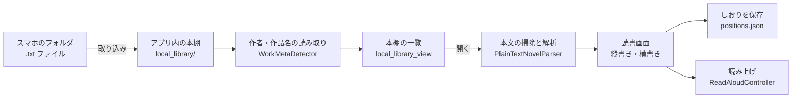
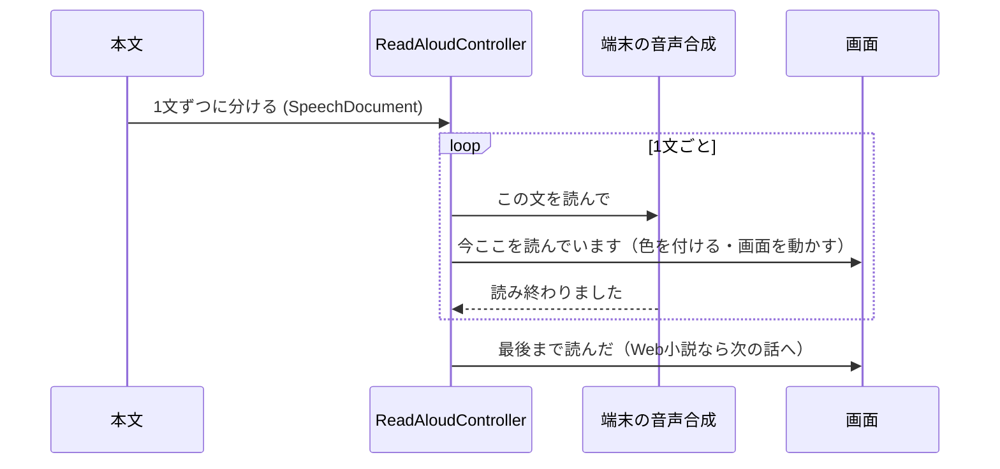

# Novelty-local 解説書

このページは、[L4Ph/Novelty](https://github.com/L4Ph/Novelty) をフォーク（自分用に複製）した
**Novelty-local** で、何を足したのか・どう使うのか・中でどう動いているのかをまとめたものです。
プログラムを読んだことがない人でも、上から順に読めば全体がつかめるように書いています。
開発者向けの設計メモ（モジュールの責務・保存形式・スレッド・CI）は [ARCHITECTURE.md](ARCHITECTURE.md) にあります。

---

## 0. まず最初に（3行まとめ）

1. 元のNoveltyは「なろう・カクヨムをネットから読むアプリ」です。
2. Novelty-local は、そこに **スマホの中のテキストファイル（.txt）を本棚に並べて読む機能** と、
   **読み上げ・しおり・見た目の調整など、読みやすくする機能** を足したものです。
3. 改造は Claude（Anthropic 社の AI）と一緒に行いました。誰が何をしたかは [6章](#6-claude-と一緒に改造したことについて) にまとめています。

> 例えるなら、元のNoveltyは「ネット書店で本を読む専用の読書灯」。
> Novelty-local はそれに **自宅の本棚** と **朗読係** と **しおり** を足したものです。

---

## 1. 足した機能の一覧

| 分類 | 機能 | ひとことで |
|---|---|---|
| ローカル本棚 | テキストファイルを開く | スマホの .txt をその場で読む |
| | フォルダごと取り込み | 数千件をまとめて本棚に入れる（アプリ内にコピー） |
| | しおり（続きから読む） | 閉じた位置を覚えていて、次はそこから |
| | しおり一覧・ローカルの履歴 | 最近読んだ順に並ぶ |
| | 作者ごとにまとめる | 作者のフォルダを作ったように見える |
| | 作者の読み取りルール | 青空文庫形式・夜伽形式・ファイル名から作者を見つける。正規表現で自分でも足せる |
| | 作者名・作品名の手修正 | 間違って読み取られたら直せる |
| | あいうえお順＋右端の見出し | 「あ」「か」…を押すとそこへ飛ぶ。漢字も読みを推測して並べる |
| | グリッド表示 | 本の表紙を並べたような表示（列の数も変えられる） |
| | HTML・注記の除去 | 本文に混ざった `<div>` や `［＃改ページ］` を消す（切ることもできる） |
| | UTF-8 以外の文字コード | Shift_JIS・EUC-JP・BOM の無い UTF-16 もそのまま読む |
| | EPUB | 著作権保護（DRM）の無い .epub を、.txt と同じように取り込む・単体で開く。ルビはそのまま、題名・著者は EPUB の目録から |
| | テキストの読み込み設定 | 元のファイルを UTF-8 に書き直す・本文の掃除・表記ゆれ（全角英数字→半角、半角カナ→全角）を選べる |
| 読書画面 | 1行の文字数の上限 | 縦に長すぎる行を短くして読みやすく |
| | 色調 | 白・生成り・黒などの背景色 |
| | ページボタン（タップ位置） | 画面の端をタップしてページをめくる |
| | 位置表示とシークバー | 下に「5 / 58」などを出し、指でまとめて移動 |
| | 読み上げ | 本文を声で読む。読んでいる文に色が付き、画面もついてくる |
| | 読み上げ中は画面を消さない | 聞いている途中で画面が暗くならない |
| | 読み上げの演技 | 台詞と地の文を読み分け、場面の感情で声の高さ・速さ・音量・間を変える |
| | VOICEVOX の声 | 四国めたん・ずんだもん・春日部つむぎ・ナースロボ＿タイプＴを同梱。中部つるぎ・暁記ミタマ・里石ユカ・九州そら・東北きりたん等は設定から公式配布元よりダウンロード。感情で声の種類を変える。パフォーマンスモード付き |
| | 英単語の読み | VOICEVOX で読むとき、英単語をカタカナにする。読みの辞書 → 内蔵の辞書（機能語・略語）→ kanalizer の推測 → 1文字ずつ、の順（`lib/read_aloud/english_reading.dart`・`native/kanalizer_jni`） |
| Web小説 | 上と同じ読書機能 | なろう・カクヨムでも読み上げ・シークバー・設定ボタンが使える |
| | 読み上げの自動送り | 1話読み終えたら次の話へ進んで読み続ける |
| | 話の途中の位置を覚える | アプリを閉じても、その話の続きから |
| | 長押しのしおり | 本文を長押しして、今見ている所にしおりを挟む（1作品3つまで。ローカル・なろう・カクヨム）。右上の🔖、またはライブラリの「しおり」タブから、冒頭30文字ほどと%で選んで開く・読み上げる |
| 運転中向け | 画面を見ずに操作 | ハンドル・イヤホンのボタン、通知、ロック画面、Android Auto で再生・一時停止・前後の文・30秒戻る/進む |
| | ナビ・電話と譲り合う | ナビの案内や電話の間は止めて、終わったら同じ文から続ける。Bluetooth が切れたら止める |
| | 画面を消しても続ける | 通知を出して「音楽アプリ」として動くので、画面を消しても眠らされない |
| | 連続再生リスト | 本棚の作品と Web 小説（なろう・カクヨム）を並べ、画面を開かずに上から順に読み上げる。Web 小説は最後に読んだ話から最終話まで話を送る。作品の切り替わりで「次は、〇〇」と知らせる |
| | 話の題を読み上げる | Web小説で次の話へ進んだとき、「第N話 サブタイトル」を最初に読む |
| | 読み方の辞書 | 読み間違える言葉に読みを登録（この作品だけ／すべての作品）。読み上げバーの🗣から、今の文を見ながら登録して読み直せる |
| 一覧 | カード表示 | なろう・カクヨムのランキングを2列のカードで（右上の切り替え）。色はジャンルごと、大きな題名とあらすじの最初の一文 |
| | おすすめ順 | ローカル本棚の並び順。最近読んだ・読みかけ・入れたばかりの作品を上に。グリッドではカードに順位が付く |

---

## 2. 使い方

### 2-1. 本棚に入れる

1. 下の「ライブラリ」→ 上の「ローカル」タブを開きます。
2. 右上の **＋** を押し、「フォルダを選んで取り込む」または「ファイルを選んで取り込む」を選びます。
3. 選んだファイルは **アプリの中にコピー** されます。元のファイルを消しても、本棚からは消えません。

- 文字コードは **UTF-8**（BOM付き・UTF-16 も可）に対応しています。Shift_JIS は読めないので、UTF-8 で保存し直してください。
- 同じファイル名のものは「取り込み済み」として飛ばします。

### 2-2. 本棚を見る

- **作品／作者** の切り替えボタンで、作品の一覧と作者ごとのまとまりを切り替えます。
- 右端の **# A〜Z あ〜わ 漢** を押すと、その行へ飛びます。
- 並べ方は、虫めがねの右の **並び替えボタン** で「タイトル順・追加順・最近読んだ順」から選べます。
- 右上の **⋮** →「表示の設定（リスト／グリッド）」で、グリッド表示や列の数を変えられます。

### 2-3. 作者・作品名を直す

- 作品を **長押し** →「作者・作品名を修正」。作品名の **読み仮名** もここで直せます（並び順が変わります）。
- 作者のまとまりを開いて右上の **鉛筆** → 作者名と読み仮名を直せます。
  別の作者と同じ名前にすると、1人にまとまります。
- 自動の読み取りに戻したいときは、長押し →「自動判定に戻す」。

### 2-4. 作者の読み取りルール

- ローカルタブの **⋮** →「作者の読み取りルール」。
- 上から順に試して、最初に当たったルールが使われます。並べ替え・オン/オフ・追加ができます。
- 自分でルールを足すときは **正規表現** を使います。`(?<author>…)` と `(?<title>…)` という名前の部分が作者と作品名になります。

```
例）ファイル名が「山田_作品名.txt」の形のとき
(?<author>[^_]+)_(?<title>.+)
```

- 夜伽のファイル名の先頭にある日時（`20110718 0045_` のような部分）は「ファイル名から取り除く部分」として消してから判定します。

### 2-5. 読む

| 操作 | 動き |
|---|---|
| 画面の真ん中をタップ | 上のバー（戻る・読み上げ・設定）を出す／消す |
| 画面の端をタップ | 次／前のページ（どこを押すかは設定で変えられる） |
| 下のシークバーを指で動かす | まとめて移動。縦書きは右から左へ進む |
| 上のバーの 🗣 | 読み上げ開始（「今見ている辺りから」「前回読み上げた文から」「最初から」） |
| 上のバーの ⚙ | 閲覧設定（文字サイズ・1行の文字数・色調・タップ位置・読み上げの速さ） |

---

## 3. しくみの解説（例え話つき）

### 3-1. 全体の流れ



### 3-2. 取り込み ―「段ボールで引っ越し」

数千件を一度に読むと画面が固まるので、**少しずつ（バッチ）・裏方（別の作業員＝Isolate）** で運びます。
段ボールを1箱ずつ運んで、運ぶたびに「何箱目」と進み具合を表示するイメージです。

### 3-3. 作者の読み取り ―「名札を探す係」

ファイルの冒頭とファイル名を見て、作者と作品名を探します。

| 形式 | 手がかり |
|---|---|
| 夜伽形式 | 冒頭の `作者：○○` の行と `「作品名」` の行 |
| 青空文庫形式 | 区切り線（`-----`）より上の、1行目が作品名・最後の行が作者 |
| ファイル名 | `作者_作品名`、`【作者】作品名`、`作者 - 作品名` など |

ルールを改良したときは「読み取り規則の版」を上げます。版が古い作品は、次に開いたときに自動で読み取り直します
（手で直した作品はそのまま）。

### 3-4. 本文の掃除 ―「ゴミ取りネット」

本文を表示する前に、読むのに要らないものをすくい取ります。

- HTML のタグ（`<div>`、`` など）→ 消す。`<br>` は改行にする
- `&amp;` `&lt;` などの書き方 → 元の文字（`&` `<`）に戻す
- 青空文庫の注記（`［＃改ページ］` など）→ 消す
- 冒頭の「【テキスト中に現れる記号について】」の説明 → 区切り線ごと消す
- タグや注記だけの行 → 行ごと消す（元からある空行は残す）

ルビ（`｜漢字《かんじ》`、`漢字《かんじ》`）と傍点（`《《強調》》`）は、ふりがなとして表示します。

### 3-5. しおり ―「ページに挟む付箋」

スクロールの位置は、Flutter では本来 **アプリを閉じると消えるメモ帳**（PageStorage）に書かれます。
そのメモ帳を **ファイルに書き出すメモ帳** に差し替えることで、閉じても位置が残るようにしています。

- 横書き・縦書きスクロール・縦書きページ送りでは位置の意味が違うので、**表示ごとに別々** に覚えます。
- スクロールのたびに書き込むと重いので、**1秒待ってまとめて保存** します。
- Web小説は **話ごと** に覚えます（最大3000話。超えたら古い順に消す）。

### 3-6. あいうえお順 ―「辞書を引いてから並べる」

漢字は読み方がわからないと並べられません。そこで **読み仮名の辞書** をアプリに入れました。


- タイトルの頭から、辞書にある **一番長い語** を当てはめていきます（最長一致）。
- 辞書にない字はそのまま残り、読めなかった漢字は「漢」の行に入ります。
- **英字・数字で始まる部分はかなに直しません**（A〜Z・# に並ぶ）。
- 手で入れた読み仮名があれば、そちらを優先します。
- 辞書は約3.8MB。電子辞書研究開発グループ（EDRDG）の JMdict（言葉）・JMnedict（人名）・KANJIDIC2（1字の読み）から作りました。
  人名の読みが何通りもあるときは、形態素解析（MeCab）の結果に合うものを選んでいます。作り方は `tool/build_reading_dictionary.py`。

### 3-7. 読み上げ ―「朗読係と、指でなぞる人」



- 文の位置は「本文の何文字目から何文字目」で表します。ルビは親文字の長さで数えるので、
  読み上げ・色付け・縦書きの配置で同じ物差しを使えます。
- 一時停止は「止めて、今の文を覚えておく」方式です。再開するとその文の頭から読み直します
  （端末によって一時停止に対応していないため）。
- 端末の音声合成は1つしかないので、新しく読み始める前に必ず古い朗読係を片付けます。

### 3-8. 読み上げの演技 ―「台本に書き込む演出家」

読み上げの前に、演出家（`SpeechDirector`）が本文を読んで、1文ずつ台本に書き込みをします。

| 書き込むこと | 手がかり |
|---|---|
| 誰が話しているか | 「」は台詞、（）は心の声、それ以外は地の文 |
| どんな気持ちか | 台詞のすぐ後ろの「と叫んだ」「と囁いた」（一番強い手がかり）、！の数・！？・…、「ふふ」「くそっ」「助けて」などの言葉、少し前の地の文の「涙」「笑み」などから作る場面の空気 |
| どれだけ間を置くか | 段落の終わり、空行（場面転換）、「……」で終わる文、話し手の切り替わり |

朗読係はその書き込みを見て、文ごとに声の高さ・速さ・音量を変え、間を置きます。
閲覧設定の「演技の強さ」で効き具合を変えられ、0% なら今までどおり淡々と読みます。
地の文と台詞で別の声（端末の音声エンジンにある声）を使うこともできます。

- 感情は「推測」です。皮肉や、手がかりの言葉が出てこない場面は読み取れません。
- 端末の音声エンジンが変えられるのは高さ・速さ・音量だけなので、声色そのもの（泣き声・怒鳴り声）までは作れません。

### 3-9. メモリの節約 ―「全部のページを刷らずに、版だけ持つ」

縦書きのページ送りでは、全ページの中身を持たずに「何ページ目はどこから始まるか」だけを覚えます。
ページを開くときに、その位置から組み直します（直近6ページ分だけ残す）。
印刷所が全ページを刷って倉庫に積む代わりに、版の場所だけ控えておいて、必要なページだけ刷るイメージです。
読み仮名の辞書も、語ごとの表を作らず、並んだ本文の上で直接探します。

### 3-10. シークバーと透明な覆い

縦書きのときは、画面の下に **透明な覆い**（GestureShield）を敷いています。
ホームへ戻る上スワイプと、本文の縦スクロールがぶつからないようにするためです。
シークバーはその覆いより **上の層** に置いているので、指で動かせます。

### 3-11. 運転中の読み上げ ―「カーオーディオにつながる名札」

スマホには「いま音楽を流しているアプリ」を1つ決めて、ハンドルやイヤホンのボタン・通知・車の画面をそこへつなぐ仕組みがあります。
読み上げにその **名札**（メディアセッション）を付けたので、車からは音楽アプリと同じに見えます。

- **ボタン** → `ReadAloudRemote` が受けて、読み上げの「再生・一時停止・次の文・約30秒戻る」に置き換えます。
  30秒は時計で測らず、「標準の速さなら1秒に8文字」として文字数で数え、文の頭に合わせます。
- **ナビ・電話** → スマホは「音を譲って」と知らせてきます（音のフォーカス）。知らせを受けたら一時停止し、
  「もう返すよ」と来たら同じ文の頭から続けます。他の音楽アプリに取られたときは、勝手には戻りません。
- **画面を消しても続く** → 通知を出している間は、スマホが「音楽を流している最中」として扱い、アプリを眠らせません。
- **連続再生** → 次の作品の読み込みと読み上げの開始を、画面の組み立ての外でやっています。
  画面が消えている間は画面の組み立てが止まるため、そこに頼ると次の作品へ進めないからです。

---

## 4. ファイルの地図（どこに何があるか）

### ローカル本棚（`lib/local_library/`）

| ファイル | 役目 |
|---|---|
| `local_library_models.dart` | 作品（LocalWork）・しおり（ReadingPosition）の形 |
| `local_library_store.dart` | ファイルへの保存・取り込み・読み取り直し |
| `local_library_providers.dart` | 画面とデータをつなぐ係（Riverpod） |
| `work_meta_detector.dart` | 作者・作品名の読み取り |
| `meta_rules.dart` | 読み取りルール（組み込み＋自作の正規表現） |
| `author_profiles.dart` | 作者名の変更・読み仮名 |
| `kana_index.dart` | 右端の見出し（# A〜Z あ〜わ 漢）と並べ替え |
| `kanji_reader.dart` | 漢字の読みの推測（辞書の読み込みと最長一致） |

### 画面（`lib/screens/`）

| ファイル | 役目 |
|---|---|
| `local_library_view.dart` | ローカルタブ（一覧・検索・並び替え・グリッド・長押しメニュー） |
| `local_author_works_page.dart` | 1人の作者の作品一覧 |
| `local_bookmarks_page.dart` | しおり一覧・ローカルの履歴 |
| `local_import.dart` | フォルダ・ファイルの取り込み |
| `local_meta_rules_page.dart` | 作者の読み取りルールの設定 |
| `local_work_reader_page.dart` / `local_text_reader_page.dart` | ローカルの読書画面 |
| `novel_page.dart` | Web小説の読書画面（読み上げ・位置バー・途中の位置の記憶を追加） |
| `settings/reader_settings_page.dart` | 閲覧設定（1行の文字数・色調・タップ位置・読み上げ） |
| `history_page.dart` / `library_page.dart` | 「Web小説｜ローカル」のタブを追加 |

### 部品（`lib/widgets/`・`lib/utils/`・`lib/read_aloud/`）

| ファイル | 役目 |
|---|---|
| `utils/plain_text_novel_parser.dart` | 文字コードの判別・本文の掃除・ルビの解析 |
| `utils/japanese_legacy_codecs.dart` | Shift_JIS・EUC-JP を読む（対応表は `tool/gen_japanese_tables.py` で作る） |
| `utils/text_width.dart` | 表記ゆれ（全角・半角）をそろえる |
| `screens/local_text_options_sheet.dart` | テキストの読み込み設定の画面 |
| `utils/line_length.dart` | 1行の文字数の上限 |
| `utils/reader_appearance.dart` | 色調とタップ位置の決まり |
| `utils/web_reading_positions.dart` | Web小説の話ごとの位置 |
| `utils/tategaki_converter.dart` | 縦書き用への変換（本文位置の対応表つき） |
| `widgets/reader_navigation.dart` | ページ・位置の計算と移動 |
| `widgets/reader_position_bar.dart` | 下の位置表示とシークバー |
| `widgets/read_aloud_bar.dart` | 読み上げの操作ボタンと開始位置の選択 |
| `widgets/persistent_page_storage.dart` | しおりの「書き出すメモ帳」 |
| `widgets/tap_zone_guide.dart` | タップ位置の見本 |
| `widgets/indexed_list.dart` | 右端の見出しつきの一覧・グリッド |
| `read_aloud/speech_document.dart` | 本文を読み上げ用の文に分ける |
| `read_aloud/read_aloud_controller.dart` | 読み上げの進行（文ごとの声の切り替え・間） |
| `read_aloud/speech_direction.dart` | 読み上げの演技（役割・感情・間の推定） |
| `read_aloud/read_aloud_remote.dart` | 画面の外からの操作（ボタン・ナビ・電話・Bluetooth）を読み上げの操作に置き換える |
| `read_aloud/read_aloud_media.dart` | 通知・ロック画面・車の画面とのつなぎ（audio_service・audio_session） |
| `read_aloud/reading_dictionary.dart` | 読み方の辞書（音声に渡す文字だけを置き換える） |
| `widgets/reading_dictionary_sheet.dart` | 読み方の辞書の画面 |
| `widgets/novel_card.dart` | 作品のカード（ランキング・ローカル本棚のグリッド） |
| `local_library/read_aloud_playlist.dart` | 連続再生リスト（`playlist.json` に保存） |
| `screens/read_aloud_playlist_sheet.dart` | 連続再生リストの画面（並べ替え・外す・再生） |
| `read_aloud/playlist_player.dart` | 連続再生の再生係（画面を開かずに読み込み・読み上げ・次の作品へ） |

### 縦書きの部品（`packages/tategaki/`）

読み上げの色付け（`highlight.dart`）、指定した場所へのジャンプ（`tategaki_text_controller.dart`）、
ページ数の通知などを足しました。

### その他

| ファイル | 役目 |
|---|---|
| `assets/dict/readings.tsv.gz` | 読み仮名の辞書 |
| `tool/build_reading_dictionary.py` | 辞書の作り方 |
| `.github/workflows/ci.yml` | 自動チェックと APK の作成 |
| `test/` | 自動テスト（ローカル本棚・読み上げ・掃除・並べ替えなど） |

---

## 5. APK の作り方と入れ方

ブランチ `feat/local-text-file` に変更を送る（push する）と、GitHub Actions が自動で動きます。

1. **Analyze & Test**：書き方のチェック（警告0件が条件）と自動テスト
2. **Build Android APK**：インストール用の APK を作る

ビルドが通ると、APK はリリース [`apk-latest`](https://github.com/SYSTEMA556/Novelty-local/releases/tag/apk-latest) に
`novelty-local.apk` として上書きで置かれます。スマホでそのリンクを開き、ダウンロードして入れます。

- **署名の鍵は固定しています**（リポジトリの Secret `ANDROID_KEYSTORE_BASE64`）。
  新しい版を上から入れても、本棚・しおり・設定は残ります。
- 鍵を変えると、次の版を入れる前に一度アンインストールが要ります（そのとき本棚は消えます）。
- 元の Novelty（公式版）とは署名が違うので、公式版と同時には入りません。
- 開発者向けの設計メモは [ARCHITECTURE.md](ARCHITECTURE.md) にあります。

- 元のリポジトリ（L4Ph/Novelty）へ Pull Request は送っていません。GitHub に
  「Compare & pull request」が出ても押さないでください（元の作者さんに届いてしまいます）。

### 5-1. 手元でビルドする

```bash
git clone -b feat/local-text-file https://github.com/SYSTEMA556/Novelty-local.git
cd Novelty-local
flutter pub get
dart run build_runner build -d
flutter build apk --release
```

- VOICEVOX の部品はリポジトリに入れていません。CI が公式の配布物から取ってきて置きます。
  手元でビルドするときは、[ci.yml](.github/workflows/ci.yml) の「Fetch VOICEVOX」と同じように置いてください。

  | 部品 | 置き場所 |
  |---|---|
  | コア（Maven パッケージ） | `android/voicevox-maven/` |
  | ONNX Runtime | `android/app/src/main/jniLibs/arm64-v8a/` |
  | 辞書・声のモデル | `android/app/src/main/assets/voicevox/` |

  コアが無いと Kotlin のコンパイルが通りません。
- release 署名は `android/app/key.properties` を読みます。CI では Secret `ANDROID_KEYSTORE_BASE64` から作ります。
- `flutter analyze` は info も含めて 0 件、が CI の条件です（very_good_analysis）。

### 5-2. 元の Novelty から増えた権限

| 権限 | 理由 |
|---|---|
| すべてのファイルへのアクセス（`MANAGE_EXTERNAL_STORAGE`） | フォルダを選んで .txt をまとめて取り込む・再スキャンする |
| フォアグラウンドサービス（メディア再生）・`WAKE_LOCK` | 画面を消しても読み上げを続ける |

カメラ・位置情報・連絡先・マイクは使いません。

---

## 6. Claude と一緒に改造したことについて

- このフォークの追加・変更は、利用者（SYSTEMA556）の指示と確認のもと、AI の **Claude（Anthropic）** が
  コードを書き、GitHub Actions の自動テストで確かめながら進めました。
- コミットには `Co-Authored-By: Claude …` の行が付いています。どの変更を Claude が書いたかは、ここから追えます。
- コードの中のコメントは日本語で、「何のためにそうしているか」を書くようにしています。
- **実機での確認は利用者が行っています。** 自動テストは通っていても、端末によって動きが違うことがあります。

---

## 7. 知っておいてほしい限界

- **読みの推測は「ほとんど当たる推測」です。** 珍しい人名や造語は外れます。外れたら手で直してください。
- **文字コードは推測です。** Shift_JIS と EUC-JP の両方で読んでみて、読めない所の少ないほうを選びます。
  ごく短いファイルや、半角カナばかりのファイルでは外れることがあります。
- 「元のファイルを UTF-8 に書き直す」は、スマホにある元の .txt を本当に書き換えます。
  読めない文字が1つでもあるファイルは、中身を失わないよう書き換えません。
- **本棚の中身はアプリの中にあります。** アプリを消す・端末を替えると、取り込んだ作品・しおり・手修正は消えます。
- 文字サイズや行の長さを大きく変えると、しおりの位置が少しずれることがあります。
- **Android Auto は、Play ストア以外から入れたアプリを最初は出しません。** 車の画面に出したいときは、
  Android Auto の設定で「バージョン」を10回押して開発者モードにし、右上の︙→「デベロッパー設定」→「提供元不明のアプリ」をオンにしてください。
  車の画面からできるのは「今読んでいる作品」の操作だけで、作品を選ぶのはスマホ側です。
- **運転中にスマホの画面を操作しないでください。** 作品と読み始める位置は、出発前に選んでおく前提です。
- 本文の掃除は「タグらしいもの」を消すため、本文に `<名前 …>` のような書き方が本当に含まれていると、それも消えることがあります。

---

## 8. ライセンス

外部のソフトウェア・データの詳しい表記は [THIRD_PARTY_NOTICES.md](../../THIRD_PARTY_NOTICES.md) にまとめています。

- 読み上げの声に **VOICEVOX:四国めたん・ずんだもん・春日部つむぎ・ナースロボ＿タイプＴ**（ほか追加した声） を使用しています。VOICEVOX の配布物はリポジトリには入れず、
  CI が公式の配布元から取得して APK に同梱します（音声モデル・VOICEVOX ONNX Runtime の利用規約で
  「アプリケーションに組み込んで再配布することができます」とされています。クレジット表記が必要です）。

- Novelty 本体は **PolyForm Noncommercial License 1.0.0**（営利目的での利用は不可）です。このフォークも同じ条件に従います。
- 読み仮名の辞書は EDRDG の JMdict・JMnedict・KANJIDIC2 をもとにしており、
  **CC BY-SA 4.0** に従います（出典の表示が必要）。アプリの「ライセンス」画面にも記載しています。
  詳しくは <https://www.edrdg.org/edrdg/licence.html> を見てください。

---

## 9. 元の Novelty の更新に追いつくには

元のリポジトリに新しい版が出たら、次の手順で取り込みます（衝突したら Claude に相談するのが早いです）。

```bash
git remote add upstream https://github.com/L4Ph/Novelty.git   # 初回だけ
git fetch upstream
git switch feat/local-text-file
git merge upstream/main
```

特に `novel_page.dart`・`novel_content.dart`・`settings_provider.dart`・`packages/tategaki/` は
このフォークで大きく手を入れたので、衝突しやすい場所です。
